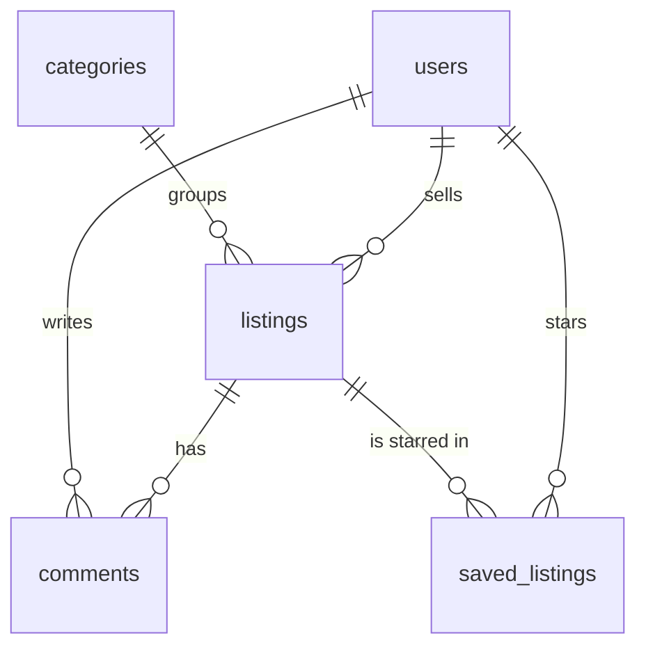

# 🧺 Turgus — local classifieds

**Turgus** (Lithuanian: *market*) lets people sell things and services nearby. Visitors search listings
by category and phrase, sellers manage their listings in an account area, members comment and keep a
★ list, and administrators moderate the marketplace.

- **Marketplace** — React single-page app (Vite + React Router + Bootstrap 5 with an own theme)
- **Account / admin area** — Node.js + Express with server-rendered EJS pages (Bootstrap 5)
- **REST API** between them, **SQLite** database (built into Node.js — nothing to install)

---

## ▶ Quick start

You need **Node.js 22.13+** (`node -v`).

```bash
npm run setup     # once: installs server + client packages and builds the React app
npm start         # http://localhost:3000
```

| Open | What you get |
| --- | --- |
| http://localhost:3000 | the marketplace (React) |
| http://localhost:3000/admin | the account / admin area |

The first start creates `server/data/app.db` with demo content.
Want a clean start? Stop the server, run `npm run reset-db`, start again.

## 👥 Demo accounts

| Account | Password | Role | Already has |
| --- | --- | --- | --- |
| `administrator` | `turgus-admin` | administrator | 1 listing, the *Administration* menu |
| `lina` | `lina-2026` | member | 4 listings, 2 saved |
| `tomas` | `tomas-2026` | member | 5 listings (1 hidden by the administrator), 2 saved |
| `spam_bot` | `spam-2026` | suspended | cannot sign in; its listing and comment are hidden |

Sign in with the username or the email (`lina@turgus.test`, …).

## 🔐 Who can do what

| | Guest | Member | Administrator |
| --- | :---: | :---: | :---: |
| Search by category and phrase, sort, open a listing | ✅ | ✅ | ✅ |
| Comment on a listing | — | ✅ | ✅ |
| ★ Save listings (stored in the database) | — | ✅ | ✅ |
| Post a listing with title, category, description, price, photo | — | ✅ | ✅ |
| Edit / delete **own** listings | — | ✅ | ✅ |
| Remove comments under **own** listings | — | ✅ | ✅ |
| Add / remove categories | — | — | ✅ |
| Suspend members, hide listings and comments | — | — | ✅ |

## 🧭 Guided tour

**1. As a guest** — open http://localhost:3000
- Type `tent` in the big search field: results change while you type (no page reload).
  Pick *Sport & Leisure* on the left (chips on a phone), switch the sort to *Cheapest first*,
  switch ▦ grid / ☰ list. The filters stay in the address bar, so *Back* works.
- Open a listing → click ☆ or try to comment → you are asked to sign in.
- http://localhost:3000/admin → the sign-in page. Try `spam_bot` / `spam-2026` → *suspended*.

**2. As `lina`** (sign in on the marketplace)
- ☆ a listing → it turns ★; reload the page or open *★ Saved*: it is still there (database).
- Open *Camping tent for 3 people* and write a comment → it appears at once.
- Click your name in the header → the account area:
  - **New listing**: send the empty form, a `.txt` file renamed to `.png`, or a photo over 5 MB —
    every problem is shown under its own field.
  - **My listings**: edit, delete, and **💬 Comments** to remove unwanted comments.
  - http://localhost:3000/admin/listings/5/edit (tomas's tent) → *Not your listing*.
  - http://localhost:3000/admin/members → *Administrators only*.

**3. As `administrator`**
- **Categories**: add one; a category that still has listings cannot be removed.
- **Members**: suspend `tomas` → that session ends, the account cannot sign in, and its listings
  vanish from the marketplace. *Lift suspension* brings everything back.
- **Review listings / Review comments**: hide and show again.

## ✅ Assignment checklist

| Stage of the task | Where |
| --- | --- |
| 1. Project and its structure | `client/`, `server/`, root `package.json` (`setup`, `start`) |
| 2. Database, models and relations | `server/db/database.js` — see *Data model* below |
| 3. Administrator interface and functions | `server/routes/moderation.js`, `server/views/moderation/` |
| 4. Listing form, validation, saving | `server/services/listings.js` (`checkListingForm`), `server/middleware/photos.js`, `views/listings/form.ejs` |
| 5. Page to edit and delete own listings | `server/routes/myListings.js`, `views/listings/index.ejs` |
| 6. REST API: search, comments, ★ | `server/routes/api/` |
| 7. Registration, passwords not in plain text | `server/services/accounts.js` (bcrypt), `views/account/join.ejs`, React `AuthPage` |
| 8. Sign-in, authentication, access rights | `server/middleware/access.js`, `server/routes/account.js` |
| 9. React SPA, mobile friendly | `client/src/` |
| 10. GitHub + README | this file |

## 🗄 Data model



| Table | Columns |
| --- | --- |
| `users` | id, username, email, password_hash, role (`user`/`admin`), blocked_at, joined_at |
| `categories` | id, title |
| `listings` | id, seller_id → users, category_id → categories, title, details, price_cents, photo, blocked_at, posted_at, edited_at |
| `comments` | id, listing_id → listings, author_id → users, body, blocked_at, posted_at |
| `saved_listings` | user_id → users, listing_id → listings, saved_at — primary key (user_id, listing_id) |

- `blocked_at` is empty for normal rows and holds the date an administrator blocked the row.
- Prices are whole cents (`1999` = 19.99 €), so there are no rounding errors.
- Deleting a listing removes its comments and stars (`ON DELETE CASCADE`);
  a category in use cannot be deleted (`ON DELETE RESTRICT`).

## 🔌 REST API

| Request | Purpose | Sign-in |
| --- | --- | :---: |
| `GET /api/categories` | categories with the number of visible listings | |
| `GET /api/listings?category=3&q=tent&sort=price_asc` | search; `sort` = `newest` · `price_asc` · `price_desc` | |
| `GET /api/listings/:id` | one listing with its visible comments | |
| `POST /api/listings/:id/comments` `{ text }` | add a comment | ✔ |
| `GET /api/saved` | my ★ listings | ✔ |
| `PUT /api/saved/:id` · `DELETE /api/saved/:id` | star · unstar | ✔ |
| `GET /api/session` | who is signed in | |
| `POST /api/session` `{ login, password }` · `DELETE /api/session` | sign in · sign out | |
| `POST /api/members` `{ username, email, password, password2 }` | create an account | |

Hidden listings, hidden comments and anything from suspended members never leave the server.
Errors come back as `{ "error": "…" }`, form problems as `{ "error": "…", "fieldErrors": { … } }`.

## 🗂 Folder map

```
client/src/
  lib/            http.js (API client, all addresses), format.js (prices, "2 hours ago")
  context/        SessionContext — the signed-in member
  hooks/          useListings (search with cancelling), useStoredState (remembered settings)
  components/     layout/ · browse/ · listing/ · ui/
  pages/          BrowsePage, ListingPage, SavedPage, AuthPage, MissingPage
  styles/         theme.css
server/
  app.js          wires everything together on one port
  db/             database.js (schema), demoData.js, reset.js
  services/       accounts.js, listings.js — logic shared by pages and API
  middleware/     access.js (who may do what), photos.js (uploads), notices.js
  routes/         account, overview, myListings, moderation, api/ (catalogue, saved, session)
  views/          EJS pages of the account area
  public/         admin.css
```

## 🛠 While developing

```bash
npm run dev:server   # Express, restarts on change (node --watch)
npm run dev:client   # Vite on :5173, forwards /api, /uploads and /admin to :3000
```
